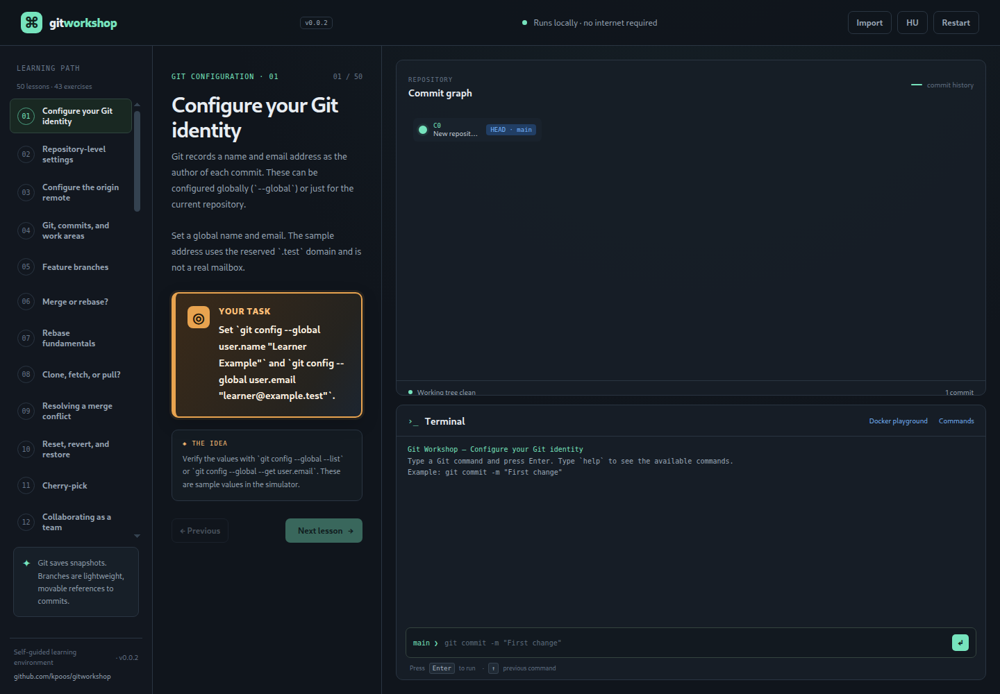
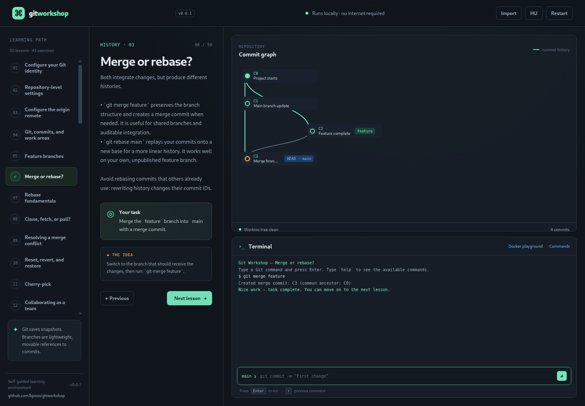

# Git Workshop / Git műhely

**English:** [README.md](./README.md)

Kétnyelvű Git tanulási környezet, amely teljes egészében egy helyi Docker konténerben fut. A fejléc nyelvváltó gombjával válthatsz angol és magyar között. A webfelületet a konténer szolgálja ki, és minden, a terminálba írt parancs valódi parancsként a konténerben hajtódik végre — semmi sem szimulált. A leckék eredeti, lépésről lépésre haladó feladatok az ágak és commitok tanulásához.

## Kiadás 0.0.4

Az alkalmazás verziószáma `0.0.4`. A fejléc és lábléc verziófeliratai az `index.html` `application-version` metaadataiból származnak.

## Képernyőképek





## Első lépések

Előfeltételek: Docker Engine vagy Docker Desktop a Compose bővítménnyel, valamint internetkapcsolat a kép első építéséhez.

A repository gyökérkönyvtárából építsd fel és indítsd el a környezetet:

```sh
docker compose up --build -d
```

Majd nyisd meg a <http://localhost:3000> címet egy modern böngészőben. A webfelület, a commitgráf és a terminál is a `git-workshop` konténeren belül fut. A port a `127.0.0.1` címre van kötve, így az alkalmazás csak a saját gépedről érhető el.

## Valós parancsok, ellenőrzött feladatok

A konténeren belüli Node szerver minden terminálparancsot a valódi `git` binárissal hajt végre egy munkamenetenkénti repository-ban a `/workspace` alatt. Parancsonként a szerver kiolvassa a valós repository-állapotot — branchek, commitok, konfiguráció, remoteok, munkakönyvtár-státusz —, és ebből építi újra a commitgráfot.

A feladatokat **a szerver ellenőrzi a valós repository-állapot alapján**. Egy feladat csak akkor számít teljesítettnek, ha a konténer repository-ja tényleg megfelel az ellenőrzésnek *és* legalább egy valós `git` parancs lefutott a konténerben a lecke betöltése óta, ahogy azt a szerver végrehajtási naplója rögzíti. A böngészőben nem történik ellenőrzés, így szimulált parancssal nem teljesíthető feladat.

A lecke-commitok megkapják a feladat-azonosítókat (`C0`, `C1`, …) címkék formájában, így a leckeszövegben szereplő parancsok, mint a `git cherry-pick C2`, a valós gitben is működnek.

A terminál fejlécében további vezérlők vannak. A **Feladat ellenőrzése** gomb igény szerint újrafuttatja a szerveroldali ellenőrzést: jelenti a bizonyítékokat (valós repository-állapot plusz a lecke betöltése óta végrehajtott valós `git` parancsok száma), teljesítéskor megjelöli az aktuális feladatot, a következő megnyomásra pedig továbblép a következő feladatra. A **Súgás** gomb lépésről lépésre tárja fel az aktuális feladatot a terminálban — először a célt, aztán a tippet, végül a konténerben futtatható pontos parancsokat.

A terminál valós shell-promptot mutat a `learner@git-workshop:~/repo$` formában, amely követi a munkamenet munkakönyvtárát, ahogy `cd`-zel mozogsz.

Ez egy korlátozott parancssor, nem teljes Bash shell. A `Tab` kiegészíti az engedélyezett parancsokat, a gyakorlómunkamenet fájl- és könyvtárneveit, valamint a Git-ágakat; több találatnál ismét nyomd meg a `Tab` billentyűt a lista megjelenítéséhez.

## Leállítás és visszaállítás

```sh
docker compose down      # konténer leállítása, a gyakorló repository-k megmaradnak
docker compose down -v   # leállítás és az adatkötet törlése
```

A névadott `git-workshop-data` kötet a munkamenetek repository-it a konténer újraindításai között is megőrzi. Az **Újrakezdés** újraépíti az aktuális feladat repository-ját a konténerben; az **Előrehaladás → Előrehaladás törlése** a rögzített teljesítéseket is visszaállítja.

## Kapcsolat és közreműködés

Látogass el a [GitHub repositoryba](https://github.com/kpoos/gitworkshop).

## Tanulási útvonal

Az alkalmazás 43 parancs-ellenőrzött gyakorlatot és irányított fogalmi leckéket tartalmaz. A kétnyelvű útvonal a Git alapjaitól a csapat-szállításig halad:

1. Globális szerzői név és e-mail beállítása.
2. Repository-szintű alapértelmezések és pull-viselkedés beállítása.
3. Az `origin` remote beállítása és kiolvasása.
4. Mit old meg a Git; munkakönyvtár, staging terület és helyi repository.
5. Feature branchek létrehozása és váltása.
6. Merge és rebase, valamint azok kompromisszumai.
7. Rebase gyakorlat.
8. Clone, fetch vagy pull.
9. Merge-konfliktus feloldása.
10. Reset, revert vagy restore.
11. Célzott javítás átvétele (cherry-pick).
12. Együttműködő branch, review és CI folyamat.
13. Kiszivárgott hitelesítő adat kezelése.
14. Branching stratégiák több csapatnak és folyamatos telepítéshez.

A fogalmi leckék a **Következő lecke** gombbal teljesíthetők. A commit, branch, merge, rebase és cherry-pick feladatok az interaktív gráfot és a konténerhez kötött terminált használják; teljesítésüket a valós repository-állapot alapján ellenőrizzük.

## Feladatok importálása

Válaszd az **Import** lehetőséget, és jelölj ki egy `.json`, `.yaml` vagy `.yml` fájlt. Az importált feladatok a tanulási útvonal végéhez fűződnek, a böngésző local storage-ében tárolódnak, és a konténerbe is szinkronizálódnak, hogy ellenőrzésük szerveroldalon is történhessen. Az azonos ID kétszeri importálása elutasításra kerül. Az alkalmazás legfeljebb 200 importált feladatot és 1 MB-os fájlt fogad el. Az **Újrakezdés** az aktív feladatot állítja vissza, az importállapot melletti **Eltávolítás** pedig minden importált feladatot töröl.

Kész importálható példák: [`custom-exercises.json`](./custom-exercises.json) és [`custom-exercises.yaml`](./custom-exercises.yaml). Mindkét formátum felső szintű `lessons` tömböt használ. Minden elemhez egyedi `id`, lokalizált `title`, `description`, `goal` és `hint` szükséges; a lokalizált szöveg lehet egyetlen string (ugyanaz a szöveg mindkét nyelven) vagy `hu` és `en` stringeket tartalmazó objektum. A `category`, `initial`, `branches` és `current` opcionális.

Minden feladathoz tartozik egy `check` objektum. Támogatott ellenőrzések:

- `{ "type": "commit-count", "minimum": 2 }` — megadott számú új commitot követel meg.
- `{ "type": "branch-ahead", "branch": "feature", "base": "main" }` — megköveteli, hogy a feature branch elhagyja az alapját.
- `{ "type": "merge-commit", "branch": "main" }` — két szülős commitot követel meg az ág csúcsán.
- `{ "type": "rebase", "branch": "feature", "onto": "main" }` — megköveteli, hogy a feature csúcsa a main-re épüljön.
- `{ "type": "cherry-pick", "branch": "main", "source": "C2", "onto": "C1" }` — a kijelölt változtatást követeli meg a célágon.

A célszövegben a tanulónak megadandó értékeket `[[dupla szögletes zárójel]]` közé zárva emelheted ki. Például: `Állítsd be az e-mailt: \`[[learner@example.test]]\`.` — az e-mail kiemelt értékként jelenik meg, miközben a parancskontextus kódstílusú marad.

Az `initial` egy opcionális commitobjektum-tömb `id`, `parents`, lokalizált `message` és opcionális `lane` (0–20) mezőkkel. A szülők a tömb korábbi commitjaira hivatkozhatnak, és a branchneveknek kiinduló commitra kell mutatniuk.

Az YAML-importáló a szokásos behúzott leképezéseket/listákat, idézett és sima skalárokat, kommenteket és `|`/`>` blokkstringeket támogat. A tabulátorok, horgonyok, címkék és más fejlett YAML-funkciók nem támogatottak. Az importáló hozzáadás előtt ellenőrzi a fájlokat, és a hibákat a felületen jelzi.

## Terminálparancsok

A terminál a konténerben fut, és rögzített engedélyezési listáról fogad valós programokat:

- `git …` — korlátlan valódi git: `status`, `log`, `config`, `remote`, `commit`, `branch`, `switch`, `merge`, `rebase`, `cherry-pick`, `clone`, `fetch`, `pull`, `reset`, `revert`, `restore` és minden más, amit a git támogat
- fájlsegédek: `ls`, `pwd`, `cat`, `echo`, `mkdir`, `touch`, `rm`, `cp`, `mv`, `head`, `tail`, `wc`, `grep`, `stat`, `find`, `date`, `whoami`, `uname`, …
- `cd <könyvtár>` — mozgás a munkamenet munkaterületén belül
- `clear` — a terminál kimenetének törlése, `help` — a gyakori parancsok listája
- kimeneti átirányítás (`echo szöveg > fajl.txt`, `>>`) és `&&` láncolás

Minden más (például `bash` vagy `node`) hibával elutasításra kerül. A konténer a homokozó: nincsenek gazdafájlok és Docker socket becsatolva, a folyamat nem privilegizált felhasználóként fut, a compose fájl pedig memória-, CPU-, folyamat- és jogosultság-korlátokat alkalmaz. Hálózatot igénylő git parancsok (`clone`, `fetch`, `pull`) a konténeren belülről futnak, így a rossz URL egyszerűen a git saját hibaüzenetével bukik el.

A konfigurációváltoztatások, remoteok és commitok a kontéren belüli munkamenet repository-jában élnek — soha nem érintik a gazdagép git-konfigurációját. A feladatelőrehaladás (aktuális lecke és teljesített feladatok) a konténer kötetében tárolódik és a böngészőbe is tükröződik.