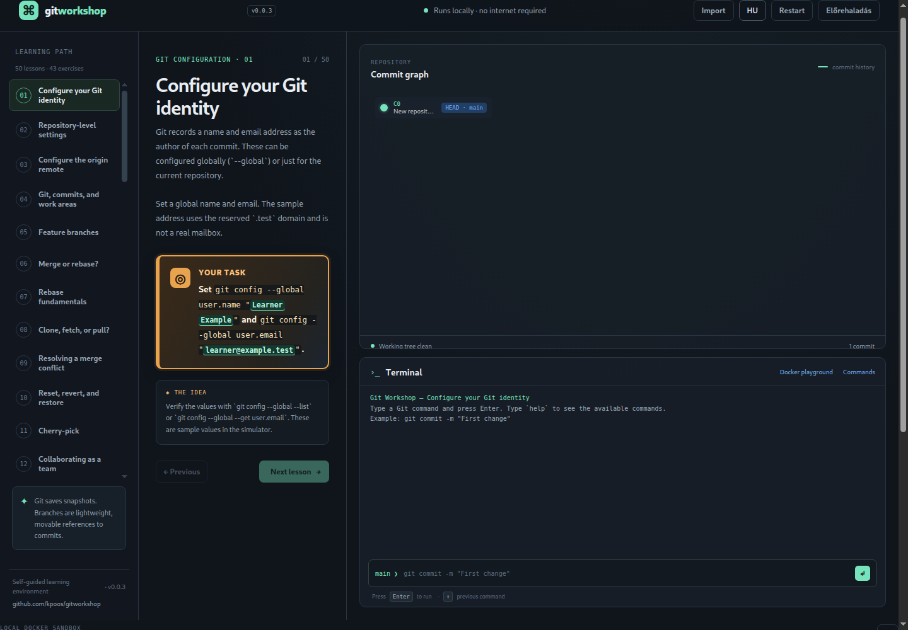
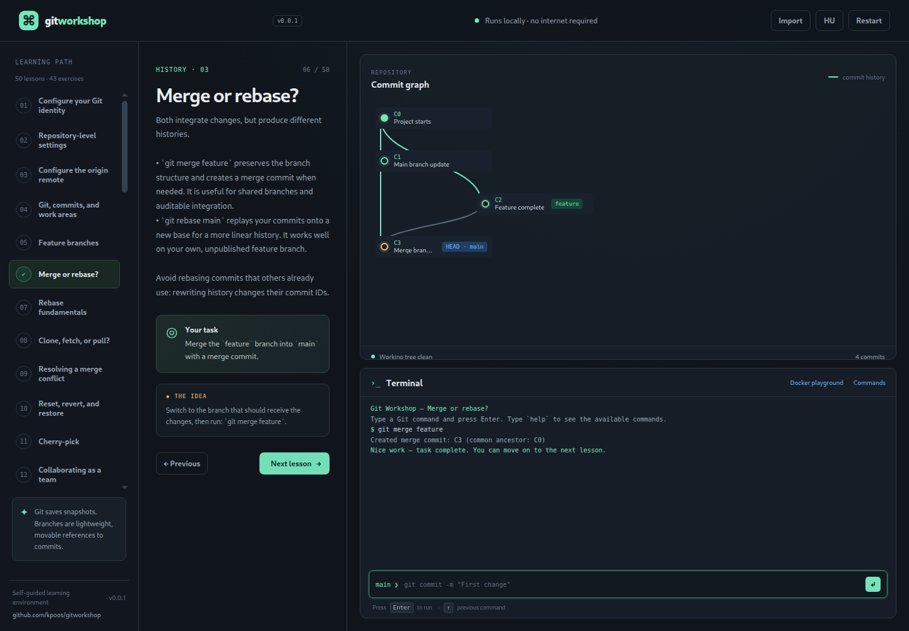

# Git Workshop / Git műhely

A dependency-free, bilingual Git learning environment. Use the language button in the header to switch between English and Hungarian. The commit graph and command line run in the browser; no Git installation, server, or internet connection is needed. The lessons are original, step-by-step exercises for learning branches and commits.

## Release 0.0.3

The application release version is `0.0.3`. The header and footer version labels are sourced from the `application-version` metadata in `index.html`.

## Screenshots





## Getting started

Open `index.html` in a modern browser. Lessons, repository state, and the command simulator run entirely in the browser.

## Local Docker playground

The **Docker playground** button opens instructions for an optional real Linux terminal. It runs locally in an isolated Alpine container; no project files or Docker socket are mounted. The terminal is exposed only on `127.0.0.1:7681`, is password-protected with a random password printed in the container logs, and the container has memory, CPU, and process limits. The container starts without Git so you can practice installing it.

Requirements: Docker Engine or Docker Desktop with the Compose plugin, and an internet connection to download the container image and install packages.

From the repository root, start the sandbox:

```sh
docker compose -f docker-compose.playground.yml up --build -d
docker compose -f docker-compose.playground.yml logs git-playground
```

Copy the printed password, click **Open terminal** in the app, and sign in as `git`. In the shell, install Git and try it:

```sh
apk add git
git --version
git config --global user.name "Learner"
git config --global user.email "learner@example.test"
mkdir first-repo && cd first-repo
git init
echo "# First repo" > README.md
git add README.md
git commit -m "Initial commit"
```

The named `/workspace` volume retains practice files across container restarts. To stop the sandbox and permanently delete that volume and its contents:

```sh
docker compose -f docker-compose.playground.yml down -v
```

## Contact and contributions

Visit the [GitHub repository](https://github.com/kpoos/gitworkshop).

## Learning path

The app contains 43 command-checked exercises plus guided concept lessons. The bilingual path progresses from Git fundamentals to team delivery:

1. Configure global author name and email.
2. Set repository-local defaults and pull behavior.
3. Configure and inspect the `origin` remote.
4. What Git solves; working directory, staging area, and local repository.
5. Creating and switching to feature branches.
6. Merge versus rebase and their trade-offs.
7. Rebase practice.
8. Clone versus fetch versus pull.
9. Merge-conflict resolution.
10. Reset versus revert versus restore.
11. Cherry-picking a targeted fix.
12. A collaborative branch, review, and CI workflow.
13. Responding to an exposed credential.
14. Branching strategies for multiple teams and continuous delivery.

Concept lessons can be completed with **Next lesson**. Commit, branch, merge, rebase, and cherry-pick exercises use the interactive graph and command simulator.

## Importing exercises

Select **Import** and choose a `.json`, `.yaml`, or `.yml` file. Imported exercises are appended to the learning path and saved in this browser's local storage. Importing the same ID twice is rejected. The app accepts up to 200 imported exercises and 1 MB per file. Use **Restart** to reset the active exercise or **Remove** beside the import status to remove all imported exercises.

See [`custom-exercises.json`](./custom-exercises.json) and [`custom-exercises.yaml`](./custom-exercises.yaml) for ready-to-import examples. Both formats use a top-level `lessons` array. Every item requires a unique `id`, localized `title`, `description`, `goal`, and `hint`; localized strings may be a single string (same text in both languages) or an object with `hu` and `en` strings. `category`, `initial`, `branches`, and `current` are optional.

Each exercise has a `check` object. Supported checks:

- `{ "type": "commit-count", "minimum": 2 }` — require a number of new commits.
- `{ "type": "branch-ahead", "branch": "feature", "base": "main" }` — require the feature branch to advance from its base.
- `{ "type": "merge-commit", "branch": "main" }` — require a two-parent commit at the branch tip.
- `{ "type": "rebase", "branch": "feature", "onto": "main" }` — require the feature tip to be based on main.
- `{ "type": "cherry-pick", "branch": "main", "source": "C2", "onto": "C1" }` — require the selected change at the destination branch tip.

In a goal string, wrap values learners must supply in `[[double brackets]]` to highlight them distinctly. For example, `Set the email to \`[[learner@example.test]]\`.` renders the email as a highlighted value while keeping the command context in code style.

`initial` is an optional array of commit objects with `id`, `parents`, localized `message`, and optional `lane` (0–20). Parents must refer to earlier commits in the array, and branch names must point to an initial commit.

The YAML importer supports ordinary indented mappings/lists, quoted and plain scalars, comments, and `|`/`>` block strings. Tabs, anchors, tags, and other advanced YAML features are not supported. The importer validates files before adding them and reports errors in the interface.

## Simulator commands

- `git status`
- `git config [--global|--local] <key> <value>`
- `git config [--global|--local] --get <key>` and `git config --list`
- `git remote add <name> <url>`, `git remote -v`, `git remote set-url <name> <url>`
- `git commit -m "message"`
- `git branch <branch-name>`
- `git switch <branch-name>`, `git switch -c <branch-name>`, and `git checkout <branch-name>`
- `git merge <branch-name>`
- `git rebase <branch-name>`
- `git cherry-pick <commit-id>`
- `git log`
- `undo` — restore the previous state
- `help`

The app is an educational command simulator, not a replacement for the Git command-line tool. Configuration and remote commands update only the simulated repository state; they do not change your computer's Git configuration or connect to a real remote. Commands such as `clone`, `fetch`, `pull`, `reset`, `revert`, and `restore` are explained in the lessons but are not executed by the simulator. Exercise progress resets when a lesson is restarted or the page is refreshed; imported lesson definitions remain saved in local storage.
